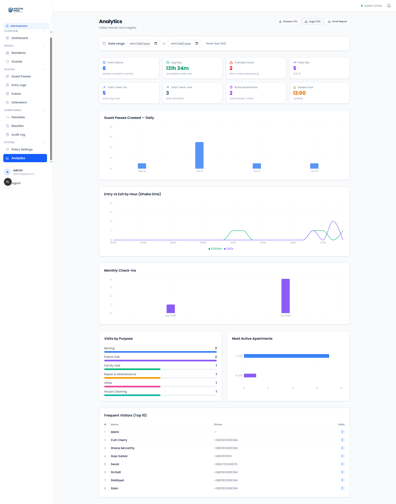
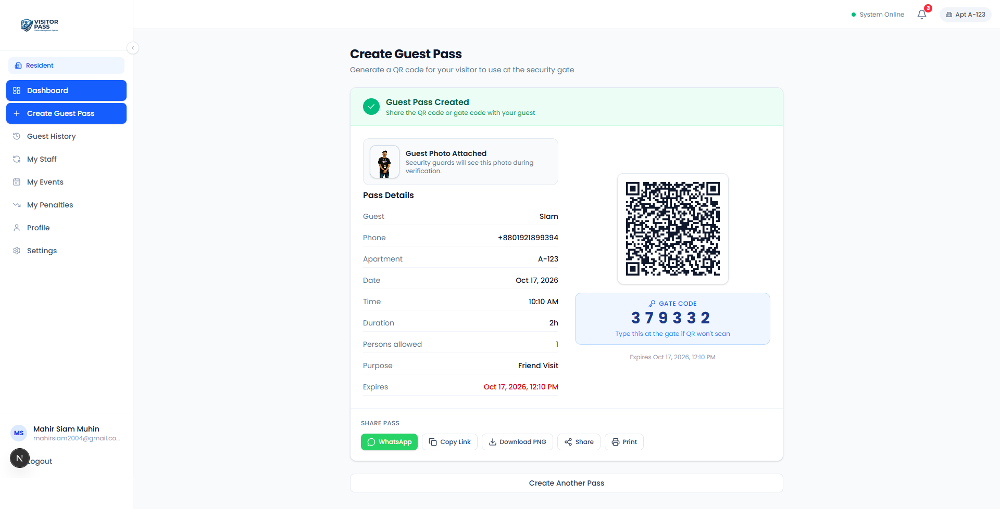
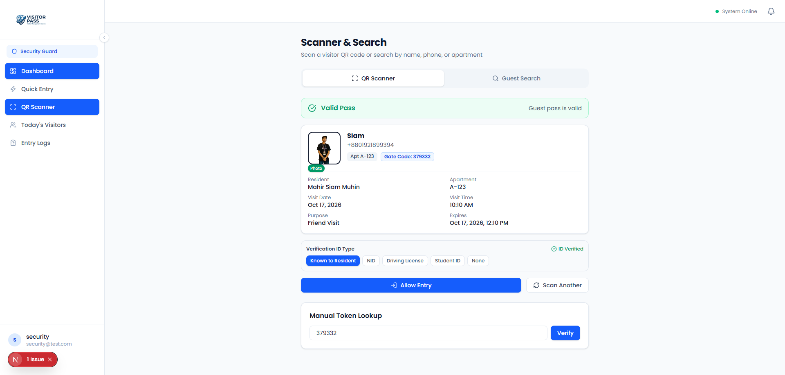
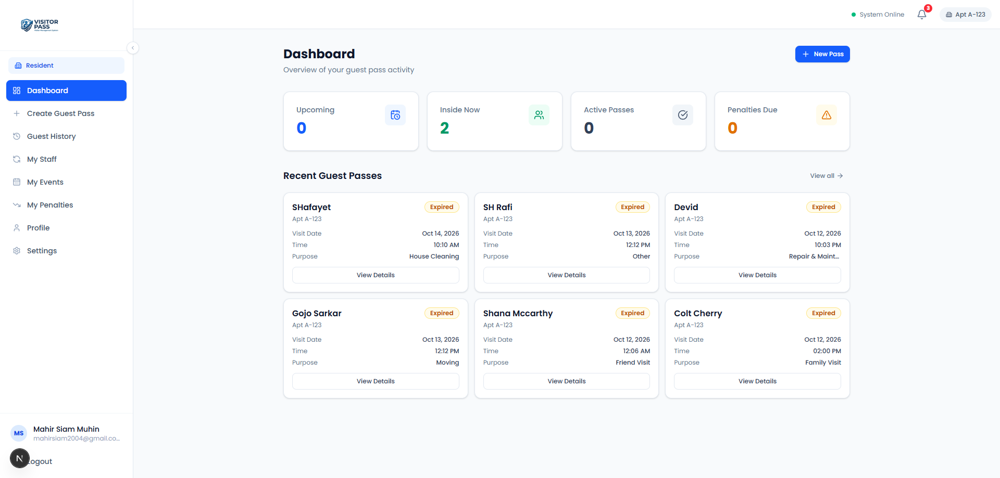
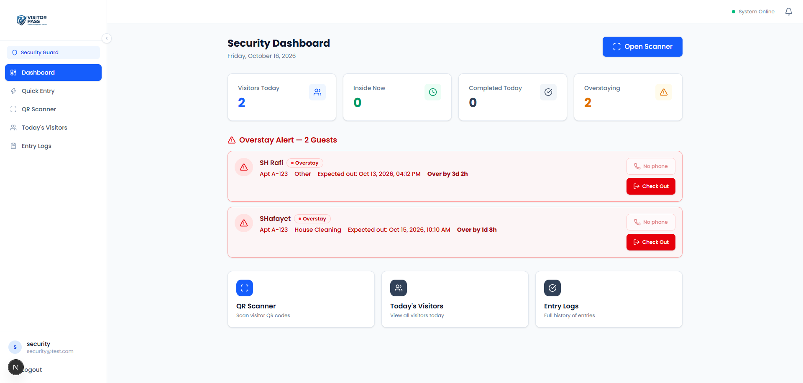

# SecureEntry — Visitor Management System

A modern, full-stack visitor management system designed for residential complexes. Built with **Next.js 16**, **Supabase**, and **Tailwind CSS**, featuring QR-based guest passes, role-based dashboards (resident / security / admin), and comprehensive entry logging.

| Category | Description |
|---|---|
| **Purpose** | Streamline visitor entry for gated communities and apartment complexes |
| **Tech Stack** | Next.js 16, React 19, Supabase, Tailwind CSS, TypeScript |
| **Key Features** | QR code generation & validation, role-based UI, entry/exit logging, guest pass management |
| **Deployment** | Deployed on Vercel (live demo available) |

---

## 📸 UI Screenshots

Below are the key UI screens from the application, displayed to give reviewers an immediate sense of the user experience.

| Screenshot | Description |
|---|---|
|  | **Admin Dashboard** — Full overview of visitors, entries, and system management |
|  | **QR Code Generation** — Generate guest QR passes with customizable validity |
|  | **QR Validity Check** — Scan and validate guest pass expiration |
|  | **Resident Dashboard** — Resident view of upcoming and past visitors |
|  | **Security Guard Dashboard** — Entry monitoring and visitor check-in interface |

---

## 🔗 Live Demo

**URL:** `@url:`https://visitor-management-system-8v4o.vercel.app/`

---

## 🏗️ Architecture

The system follows a clean client-server model:

- **Frontend**: Next.js 16 with App Router, React 19, Tailwind CSS 4
- **Backend & DB**: Supabase (PostgreSQL, Auth, Storage)
- **Deployment**: Vercel (continuous deployment from `main` branch)
- **Styling**: Tailwind CSS with custom component library (lucide-react, framer-motion)

---

## ⚠️ Important Notes

- This repository is provided **as-is**, without warranty of any kind. It is intended for **portfolio and educational demonstration purposes only**.
- **Never commit real credentials, API keys, or environment secrets.** Use the provided `.env.example` and supply your own values in a local `.env.local` (which is gitignored).
- Before any real-world or production use, conduct your **own independent security review** — verify Supabase Row-Level Security policies, authentication flows, and secret-management practices.
- The included Supabase schema and configuration are **examples only**. Provision your own backend and **rotate all keys** after deployment.
- Unauthorized use, redistribution, or deployment of this code for commercial gain is strictly prohibited.

---

## 👤 Developed by

**Mahir Siam** — Full-Stack Developer

---

## 📦 Quick Start

```bash
# 1. Clone the repository
git clone <repository-url>
cd secure-entry-vms

# 2. Install dependencies
pnpm install

# 3. Configure environment variables
cp .env.example .env.local
# Edit .env.local with your Supabase URL and anon key

# 4. Run development server
pnpm dev
```

Visit `http://localhost:3000` to see the application locally.